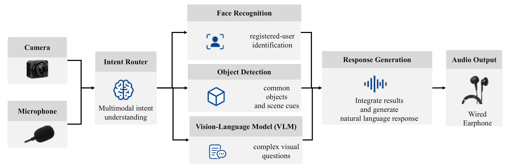

# Offline Smart Glasses · 离线智能眼镜

**Local multimodal inference · Python · OpenCV / ONNX Runtime · ESP32-S3 firmware**

XIAO ESP32-S3 Sense streams camera and microphone input over USB or Wi-Fi to a local computing host. The host runs object detection, face recognition, speech recognition, visual question answering, and speech output.

**Status:** prototype with Windows setup, a local web console, transport code, and tests. Raspberry Pi migration is documented; real Pi latency, thermal stability, battery life, and wearable reliability still need measurement. First-time model downloads require internet access.



| Component | Source |
| --- | --- |
| Vision inference | [glasses/vision.py](glasses/vision.py) |
| Speech | [glasses/speech.py](glasses/speech.py) |
| Visual question answering | [glasses/vlm.py](glasses/vlm.py) |
| Service integration | [glasses/service.py](glasses/service.py) |
| Capture firmware | [hardware/xiao-esp32s3/](hardware/xiao-esp32s3) |
| Evaluation boundaries | [Raspberry Pi migration](docs/raspberry-pi-migration.md) |

The illustration documents the architecture; it does not establish measured performance. Local use requires your own models, device configuration, and authorized face-enrolment data.

## 中文使用说明

XIAO ESP32-S3 Sense 通过 Wi-Fi 或 USB 采集图像和音频，主机在本地完成中文语音识别、物体检测、人脸识别、视觉问答和语音播报。

## Windows 快速开始

安装 Python 3.12 后，在 `project` 目录运行：

```powershell
Copy-Item config.app.example.json config.app.json
py -3.12 -c "import sqlite3; from pathlib import Path; db=sqlite3.connect('database/smart_glasses.db'); db.executescript(Path('database/schema.sql').read_text(encoding='utf-8')); db.close()"
New-Item -ItemType Directory -Force database/images
.\scripts\bootstrap.ps1
.\Start-Glasses.ps1
```

已有本地配置与数据库时，跳过复制和初始化。首次安装需要联网下载模型，运行时可离线。打开 <http://127.0.0.1:8765> 进入控制台。

示例配置使用电脑摄像头和麦克风。使用板卡时，按 [无线采集](docs/wireless-capture.md) 或 [USB 采集](docs/usb-capture.md) 配置固件和设备 MAC，并将 `sensor_source` 改为 `xiao_wifi` 或 `xiao_usb`。

- [运行、人物登记与测试](README-AI.md)
- [SQLite 数据库接口](docs/database-interface.md)
- [Raspberry Pi 迁移](docs/raspberry-pi-migration.md)
